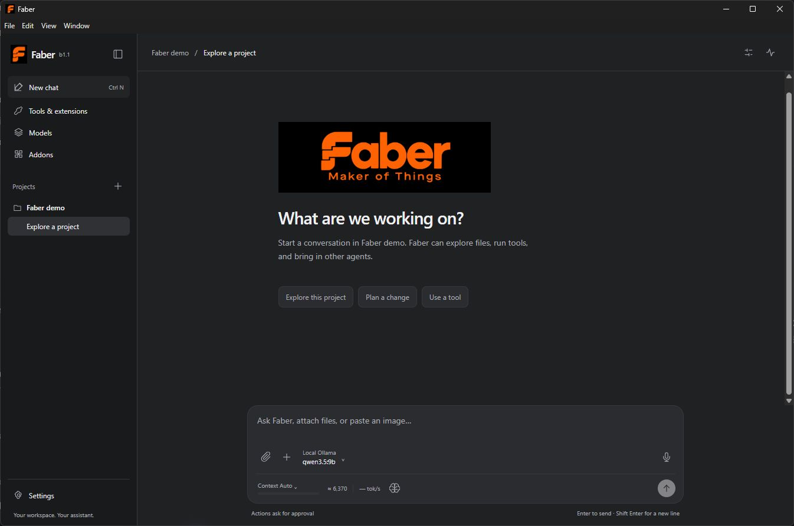
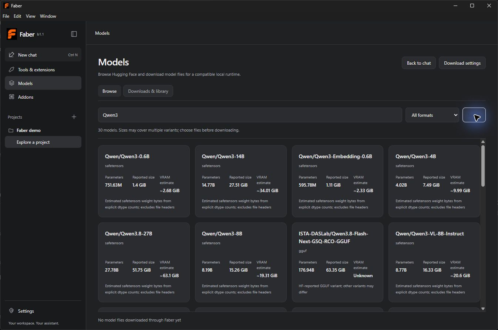
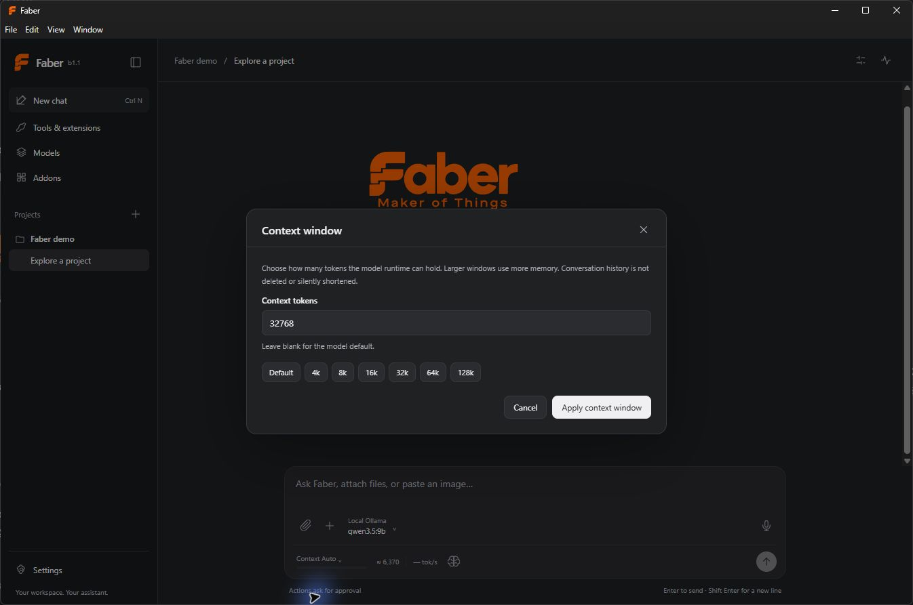
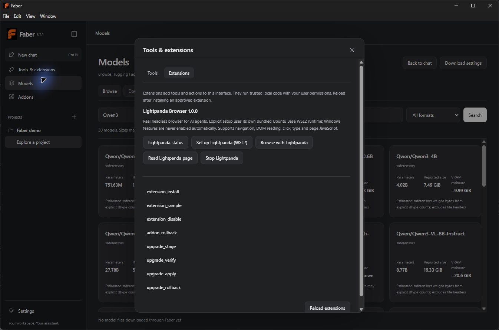

# Faber a3.0


Faber is a Windows desktop workspace for local and API-connected AI agents,
with a Codex-style interface, shared tools, agent delegation, voice, and upgrades
the agents can author. It has its own source, launchers and release lifecycle.

Faber is in closed development. Versioned installers and patch notes are available to authorized testers in this private repository.

**a3.0 adds consented live video and brings the media and worker workflows together.**
Choose a camera, screen or window and review the selected source and paired
viewer before starting. A visible Live indicator and Stop control stay available
while you return to chat. Disconnecting, hiding Faber or locking Windows ends
the share; reconnecting requires fresh host approval. Live video has no audio
or recording. [Live sharing](LIVE_MEDIA.md) · [a3.0 notes](docs/a3.0-release-notes.md)

This closed release retains project-scoped jobs, approvals, action receipts and
recovery, plus local and encrypted remote previews for documents, music,
interactive outputs and static 3D models. Extended hardware, WAN, pre-login and
seven-day acceptance remain separately tracked. [Acceptance status](docs/a3.0-acceptance.md)

Native Safetensors uses the verified CPU runtime in a3.0. The pinned upstream
Mistral.rs Windows CUDA candidate could not build because its paged-attention
CUDA APIs are exposed only on Unix. No engine fork is included. GGUF llama.cpp
and the separate Ollama GPU route were verified independently.

**a2.9 adds reviewed Outlook work, stronger recovery and 3D chat previews.**
Connect an Outlook account to one project, page through unread messages, prepare
reply drafts and review calendar changes. Sending and invitations retain their
separate approval. Paired computers can inspect the host Work Inbox, approve a
named step, steer or stop a job, and reconnect through a configured relay address.
[Outlook](MICROSOFT365.md) · [Paired work supervision](docs/a2.9-remote-work.md)

Boot-eligible local routines have a separate opt-in and a credential-free
headless worker. Signed-in headless generation and handoff to the visible app
passed; an actual reboot before sign-in remains pending during closed use.
Routine backups restore paused and require renewed scope review. Independent
action receipts and installer-owned recovery helpers preserve completed work.
[Boot and recovery](WORKER-RECOVERY.md)

Open static GLB, glTF or STL models in chat to orbit, pan and zoom. Supply and
authorize external buffers/textures explicitly; Save As keeps their original
bytes. The same previews work through the paired encrypted connection.
[3D previews](docs/a2.9-scenes-verification.md)

The local model picker adds verified native MTP or a compatible separate GGUF
draft and its speculative-token limit. Tested CPU output matched Off; the
tested GPU native-MTP output differed from Off, so choose Off when reproducing
that baseline matters. Native Safetensors precision remains CPU-qualified in
this release. [Model options and observed limits](docs/a2.9-speculation.md)

**a2.8 connects approved MCP tools to a project.** Chats can read or edit a specific Excel range, and compatible Safetensors models have a pre-Start precision slider with memory estimates and an observed precision report. [MCP and workbooks](MCP.md) · [Safetensors precision and fit](docs/a2.8-native-precision-fit.md)

**a2.7 adds scheduled work to the Work Inbox.** Choose a time or a stable new file as a trigger, set limits, and review the inputs and outputs of each job. The daily folder report can run with the window closed. [Schedules and the Work Inbox](SCHEDULER.md)

Supported original Safetensors models can load in float32, Q4 or Q8. Faber preserves the downloaded weights. [Model loading and verification](docs/a2.7-safetensors-quantization.md)

**a2.6 can keep a reviewed routine running after its window closes.**
Open Routines, select a project and the tools it may use, then preview and enable
it. Reopening Faber reconnects to the worker. Interrupted actions appear for
review when their outcome cannot be verified. [Worker and routines](WORKER.md)

Chat previews support PDF, DOCX, SVG and animated images. Highlights and notes
belong to the specific document revision and page. Settings → Applied upgrades
shows self-upgrade titles, changed files and rollback information.

**a2.5 added model packages, music generation and in-flight chat controls.**
Choose a complete Safetensors package in Models, or select the five components
for MiniMax Music3. A chat can generate a WAV using the bundled Windows CPU
runner and return it to local or paired playback. [Music setup](MUSIC.md)

During a run, **Steer now** sends a correction to the current task. **Queue
follow-up** keeps the next instruction for a safe point. The activity row shows
reported or estimated output tokens as they arrive. The transcript shows prompt
usage across model calls and identifies gaps when a provider omits its counts.

**a2.4 introduced audio and video playback in local and remote chats.**
Use the playback controls to pause, seek or adjust volume, and open videos in
fullscreen. Right-click chat content to copy text or images and save displayed
images, audio or video with the Windows Save As dialog. An agent can publish a
saved project recording or generated clip with `media_show`.
See [Chat media](MEDIA.md) for formats and limits.

**a2.3 brought remote chats into the main sidebar and added image transfer.**
Local projects stay visible while you work on another PC. A blue globe identifies
remote chats, with project and device details on hover or keyboard focus.
The paired host supplies its displayed images through the encrypted connection.

a2.3 also adds **Settings → Permissions** defaults for new chats, native Windows
project-folder selection, clearer project/chat indentation and compact local
model names. The ChatGPT sign-in button matches the account actions and disappears
once an account is connected. Existing chat permissions stay unchanged.

Remote sessions were introduced in a2.2. Pair a laptop with your home PC to
browse projects, send messages, follow agents and approve or stop work while
the model runs at home. The release includes a standalone Windows relay kit
for testing across networks. [Pair two PCs](REMOTE.md).

**a2.1 fixed a ChatGPT streaming bug** that could erase a completed reply or drop
a requested tool call when the final event contained an empty output list.
Faber now recovers completed items from the stream and runs each validated tool
call once. If only partial text arrived, it stays visible with an error.

Download Windows installers, relay kits and checksums from [Faber releases](https://github.com/youwebaba/Faber/releases).
Each version has its own full release, patch notes and installer. Earlier
versions are available in the [release history](https://github.com/youwebaba/Faber/releases).

## Rust migration

Faber retains the Rust metadata worker introduced in RMb2.0.1. GGUF parsing
runs in a compiled subprocess using a read-only file handle validated by the host.
The interface, agent orchestration, providers, local inference and addon APIs
continue in JavaScript. This is a hybrid metadata migration, not a replacement
inference engine.

Core upgrades can stage Rust source, compile and test it, then activate it with
the existing backup/rollback workflow. Compiled changes require a backend
restart. The installer includes the worker; normal use requires no Rust compiler.
Authoring Rust upgrades requires the pinned toolchain and Windows C++ build tools.
See [Rust migration and upgrades](RUST_MIGRATION.md).

## Included from b2.0.1

- First-run quick start with **Continue with ChatGPT**, optional API setup and
  explicit guidance to select local CPU/GPU hardware. Claude is marked Coming Soon.
- An **OpenAI** model-picker tab for linked ChatGPT accounts. Available models
  come from that account's catalog. Context capacity and reasoning options appear
  only when supplied; Faber does not invent model access or adjustable limits.
  See [ChatGPT connection](CHATGPT.md) for setup and current verification limits.
- **Edit → Settings** with UI, system prompts, connections, models/hardware,
  voice, addons and support categories. Interface scale is saved from 75% to 150%.
- Editable prompt presets for content creation, education, extraction, meetings,
  coding, general assistance and self-upgrading. Select a prompt when choosing a
  model or apply it to a chat in Settings. Existing chats retain their saved text;
  changes take effect on the next run.
- Formatted replies: emphasis, underline, strikeout, text colors, nested lists,
  tables and code. Valid embedded raster images appear in chat; `images_show`
  displays a saved project screenshot/image. Remote image URLs are not fetched
  automatically, and this tool does not itself generate images.
- Green triangle Start and red square Stop controls, tighter top spacing, and
  chat families that keep every agent below its parent. A parent reply promotes
  the family; child replies only reorder that parent's agents.
- **Report a bug** builds an editable draft from recent errors and opens the
  repository's GitHub issue page after review. Nothing is submitted automatically.

## New in Alpha 2.0

Alpha 2.0 includes the following roadmap features. The new internal version
selects a fresh `FaberWorkbench\2.0.2-alpha.1` source base while retaining profiles,
credentials, addons and model locations. Earlier workbenches/custom core edits
remain available and are not automatically merged. Reinstalling the same
internal version reuses its workbench. See [INSTALLING.md](INSTALLING.md).

- Busy-chat followups queue with their text/images and join the next model turn
  after the current assistant/tool-result group completes. Stop remains available.
- Cross-project inspection, messages and structured file access require permission
  for the specific target project. Revocation cancels dependent work and pending
  approvals. Shell/native grants still carry Windows-account authority.
- Local profiles keep separate chats, credentials, settings and browser state.
  Switching restarts the app, guards drafts/forms and blocks active runs,
  downloads, voice, updates and external requests. The source workbench is shared;
  profiles are not OS sandboxes.
- Startup readiness tracking and Safe Mode suppress automatic addon loading.
  Installer-owned recovery can roll back an eligible upgrade, disable addons or
  remove addon code while retaining private data. Executable cleanup is skipped;
  owned external resources may need manual cleanup.
- Before staged apply/rollback and approved shell commands, the host snapshots
  covered application source/assets, tests, manifests and the active Rust worker.
  Model weights, profiles and dependency/runtime caches are excluded.
- **Settings → External access** configures off-by-default, authenticated
  OpenAI-compatible model serving and project-bound MCP tools. Explicit remote
  binding uses unencrypted HTTP; see [GATEWAY.md](GATEWAY.md).
- **Settings → UI → Overall run time limit** supports custom minutes or Off.
  Changes apply to active/future runs from their original elapsed start;
  a shortened elapsed deadline can stop work immediately. Separate tool/network/
  gateway deadlines and Stop/Force stop still apply.

Clustering, installer signing and online addon sharing remain excluded.

The **Browser** toolbar button opens a tabbed Chromium pane beside the chat.
Drag its divider or use the divider's arrow keys to resize it; Faber remembers the
width. Tabs and website sign-ins persist in each chat's separate browser profile.
The address bar supports addresses and Google searches, with back/forward,
reload/stop, history, bookmarks and downloads. **Take over** opens the real page
for ordinary mouse/keyboard interaction, forms, selection, copy/paste and file
pickers while pausing agent browser access. Navigating or changing tabs yourself
also takes human control. **Resume browsing** explicitly returns
that access; agents must observe the page again before continuing.

Agent monitoring uses live screenshots sized to the pane. Structured and
screenshot-based tools send input inside Chromium, without moving the Windows
pointer, injecting OS keys or activating a window. Browser shortcuts, find and
page zoom work within the browser pane; the chat and composer remain available.
Lightpanda remains available separately. See [Visible Chromium browser](BROWSER.md)
for tools, persistent storage, ownership and supported browser behavior.

Context recovery now condenses older conversation into a separate model-facing
checkpoint before a known window fills, or after a provider context rejection.
The complete visible/saved chat remains available. Alpha 2.0 validates
structured handoffs and original message references, retries invalid handoffs
once, and retains selected exact historical user literals outside the summary.
Old checkpoints are ignored for model input and rebuilt from saved originals
when needed; failed/canceled rebuilds preserve prior storage. Upgrading may need
one extra compaction. Summaries remain lossy and use extra model calls. Thinking
pulses while waiting, provider progress is shown when available, and completed
Responses output reconciles streamed text.

## Screenshots

Faber b1.1 on Windows, captured in a clean demo profile. These historical
screenshots predate Alpha 2.0; current features are described above.

**Workspace** — projects, chats, model selection, attachments, voice, and
context, token-speed and thinking controls in the composer.



<details>
<summary>Explore model browsing, context controls and the Lightpanda addon</summary>

**Model browser** — search Hugging Face and compare model parameters, download
sizes and estimated VRAM requirements.



**Context window** — choose a preset or enter a token capacity for supported
local runtimes and APIs.



**Lightpanda addon** — the bundled browser exposes setup and browsing actions
through Tools & extensions.



</details>

## Windows installer

The `Faber-Setup-a2.1-x64.exe` installer installs **Faber.exe** and shortcuts
without a terminal window.
It includes Electron and a local model runner with CPU, CUDA and Vulkan backends;
model weights are downloaded separately. Existing b1 profile data
and the selected model library remain in their original locations.

**Models** provides a grid of local variants and download cards. Click a card for
details. The library scans real files; a completed transfer record alone does
not prove a model is still present. **Delete** moves the selected variant's actual
files to Windows Recycle Bin, including existing files of an incomplete variant.
It refuses active models and overlapping downloads. Emptying Recycle Bin is a
separate user action; deletion does not immediately reclaim the model's space.

The managed local model picker offers automatic, CPU and custom hardware modes,
GPU and CPU resource selection, threads, and disk-backed model memory. These
settings control the harness-owned runner, not remote API servers or another
application's Ollama server. Requested settings and observed placement are shown
separately. Memory mapping is not disk-as-VRAM and cannot disable Windows paging.
There is no new harness context or turn limit.

**Addons** manages local feature packages and their tools/buttons. See
[ADDONS.md](ADDONS.md) for the import format, trust model, reset/removal and
AI-authoring contract. Online addon sharing and OTA updates are not included.

Composer controls include context size/usage, TPS and a per-chat thinking
slider. Sidebar menus manage chats/projects, and expandable activity shows work. See
[CHAT_CONTROLS.md](CHAT_CONTROLS.md) for supported providers and behavior.

b1.2rc places each activity batch beside the output that triggered it as work
happens. The model selector and run details show the detected model name instead
of a managed server alias. Agents can use `system_time` to read the PC's current
date, time and timezone without a shell prompt.

[Lightpanda](LIGHTPANDA.md) is the first bundled removable addon. The verified
shipped addon sets up and starts its own WSL2 browser runtime when a browser tool
needs it, then releases idle chat sessions and stops its owned runtime. These
browser tools do not repeatedly ask for computer/network approval. WSL2 must
already be available; Faber does not enable Windows features or reboot the PC.
Lightpanda 1.0.2 supports one browsing chat at a time; another chat receives a
busy result until the owner releases its page or automatic cleanup runs.
Other addons and general PC/shell tools retain their existing permissions.

The installed base seeds an editable, versioned workbench for reviewed core
self-upgrades. A subsequent installer preserves the existing profile and addons,
and starts its own version's workbench rather than silently applying old core
patches to new application code. Source-mode setup remains available below.
See [INSTALLING.md](INSTALLING.md) for installation, updates, recovery and builds.

## Run

Requires Windows, Node.js 24 or later, the npm dependencies in the lockfile, and
the Rust build prerequisites in [INSTALLING.md](INSTALLING.md).
Use `Start-Faber.cmd` to launch the built executable when present, or set up and
launch the source app. For manual setup, run `npm ci`, `npm exec -- install-electron`,
then `npm run prepare:native` and `npm start` in this folder. `npm test` runs deterministic checks. `npm run smoke`
checks the desktop with isolated data; it does not prove a model can complete
arbitrary tasks.

`npm run smoke:live` additionally sends real requests to the local Qwen model
through the actual composer and checks tool results and Stop. The microphone is
not used by either desktop smoke command.

For the local connection, run the installed Ollama service, choose Local Ollama
in the connection settings, and test `http://127.0.0.1:11434`. Select an installed
model with tool support, such as `qwen3.5:9b`. No model download or cloud fallback
is implicit. A connection check lists models; it does
not establish their reasoning, vision, or tool-use quality.
Endpoint redirects are rejected. API keys require HTTPS except on loopback.

## Connect a cloud model to a chat

Click the model selector beside the composer, then **Add cloud/API connection**.
You can also add connections in Settings. Choose **OpenAI Responses API** for
OpenAI models using harness tools. Enter your API key in the app, select an exact
model ID, and optionally set the reasoning effort. Suggested IDs are
`gpt-6-astra` and `gpt-6.1-sol`; availability depends on your API account.
**Save & list models** checks access to the model catalog without sending an
inference request. **OpenAI-compatible Chat Completions** supports other servers
implementing that protocol, with their own endpoint and model IDs.

Saving a connection leaves the chat's model unchanged. Select the connection
and model, then **Use in this chat** to apply it to the next run. The composer
shows both connection and model. Cloud calls send conversation text and tool
results to the selected endpoint and use the provider's API billing. API keys
remain in the encrypted host store. Editing an endpoint's origin requires
explicitly replacing or removing its saved key; finish or stop active runs
before editing their connection.

Cloud models receive the same agent, file, PC and staged-upgrade tools as local
models, under the existing approvals. No cloud fallback is automatic. OpenAI's
[model guide](https://developers.openai.com/api/docs/guides/latest-model)
requires Responses for Astra and GPT-6.1 Sol tool calling; a connection catalog
check does not prove inference access or task quality.

The full transcript is retained without the former character/message budget or
turn-count cutoff. Model input uses that history until compaction replaces older
groups with a fallible checkpoint; saved originals remain available. Provider
context limits and API usage still apply. Context selection configures supported
runtimes without deleting history. The overall run time limit defaults to ten
minutes and is adjustable or Off in Settings → UI. Stop remains available;
individual tool/network deadlines remain separate.

Chat and agent inspection tools return message/result references instead of
embedding another full transcript. Selected messages and tool results remain
readable on demand. Existing inspection snapshots are compacted only in model
input; the saved transcript is preserved. Ordinary content/results remain
intact in storage; checkpointed model input may summarize older groups.

The chat's **Activity → Token usage** view lists each model call's input and output counts
reported by the provider, including calls made between tool executions. Missing
usage is labeled **Not reported**, including older calls recorded before this
feature. Cached input and reasoning counts, when reported, are included within
the input and output totals. These are usage counts, not the rate-limit error's
requested-token estimate or a billing calculation. Responses and Ollama report
usage directly; Chat Completions connections are asked for streaming usage.

Paste an image into the message box with **Ctrl+V**. Review or remove its preview,
then send it with text or on its own. PNG, JPEG and WebP are supported, up to
eight images and 8 MiB of encoded attachment data per message. Image drafts stay
with their chat until sent or removed. Sent images remain in that chat's model
context, so use a model that supports vision. Images are sent to the selected
connection along with the conversation; changing the connection changes where
future requests are sent. Clipboard image drafts are held in memory, like text
drafts; restarting the app clears unsent drafts.

## Find and download models

Open **Models** in the sidebar to search Hugging Face. Results show parameter
counts, available weight sizes and labeled VRAM estimates. Select a repository
to inspect its files. The GGUF quantization picker groups published variants by
nominal bit depth, shows their combined sizes, and selects every shard in the
chosen variant. Incomplete shard sets cannot be downloaded through the picker.
Unrecognized formats and supporting files remain available through manual file
selection. The **Download** button starts a background transfer. **Downloads &
library** shows progress, bytes per second, destination, errors and Cancel.

In **Settings → Model downloads**, choose the destination for future downloads.
For new profiles the default is `%LOCALAPPDATA%\Faber\models`. Existing files and active
transfers stay in their original folder. An optional Hugging Face read token is
stored using the desktop's encrypted secret store; accept gated-model terms on
Hugging Face before downloading restricted files.
Use a local folder on a filesystem supporting hard links, such as NTFS.
Interrupted transfers do not resume; a crash may leave a hidden `.partial` file.

Agents have `hf_search_models`, `hf_model_details`, `hf_download_model`,
`hf_download_status`, `hf_cancel_download` and `hf_set_download_directory` in
their shared tool registry. Downloads use the same manager and appear in the
same UI. Agent downloads require network and file permissions.

To load a downloaded model, open the model selector beside the composer and
choose **Downloaded models (local)**, or a local Ollama connection. The local
model dropdown reads the folder configured in **Settings → Model downloads**.
Click **Refresh folder** after adding files manually. Complete GGUF files and
shard sets can be started; incomplete downloads, auxiliary files and unsupported
formats cannot be loaded through this picker.

Choose a model and click **Start model**. Downloaded GGUFs run directly in a
managed local server; existing Ollama models load through Ollama. Loading status
and failures appear in the selector. Click **Use in this chat** when ready to
apply the connection and model. **Stop model** unloads it; active chats using
that model must be stopped first. Starting does not download weights or change
the chat's selection. See [local model controls](LOCAL_MODELS.md) for runtime
requirements and supported formats.

Downloaded files still need a runtime that supports their architecture and
format. This feature does not convert weights.
VRAM is a heuristic, not a fit guarantee. The [Hub contract](HUGGINGFACE.md)
describes metadata sources and transfer behavior. `npm run smoke:models` checks
the real desktop using controlled metadata and streamed test files.

## How the pieces fit

The sandboxed interface talks to the desktop host through a small request/event
bridge. The host owns Windows integration and key encryption. The agent runtime
owns projects, conversations, runs, approvals, and the shared tool registry.
Model adapters translate that same conversation and tool contract for native
Ollama or an OpenAI-compatible API. A different adapter can be added without
rewriting the interface or individual tools.

Agents use the same validated registry under their current authority. Delegation
creates another durable chat and child run. Same-project children inherit bounded
parent authority; another project needs its own approval and does not inherit
file/shell grants. Stop propagates to descendants and approvals; interrupted work
is not replayed on restart. Coordination metadata/reads are scoped to authorized
projects. External MCP sessions use a fixed tool subset.

Modules are ordinary source files behind the contracts in [CONTRACT.md](CONTRACT.md).
An extension registers tools plus declarative UI actions. The interface creates
buttons and argument forms from those actions, allowing an added feature to
have a visible entry point. Core and interface changes use staged upgrades,
verification, activation, and backups for rollback.

## Upgrade and recover

An agent can inspect source with the file tools, call `upgrade_stage` with the
changed files, run `upgrade_verify`, and request `upgrade_apply`. Activation
shows the changed file list and retains source backups. Renderer-only changes
refresh the interface without restarting the desktop host. Running chats,
downloads and loaded models stay in that host. Composer text and attachment
drafts are handed to the refreshed page through temporary host memory.

Refresh waits while you are editing a form, browsing Models, sending a message,
reading attachments or using voice. A notice explains when an update is waiting.
**Settings → Refresh interface** also loads UI edits made through the normal
development workflow. It refuses to refresh if backend source has changed since
startup. Unsubmitted connection credentials and other form fields are not copied
into the handoff; finish or close those forms first.

Core, desktop, preload, tool implementation and model-manager source changes
still require **Settings → Restart app**. Mixed UI/backend upgrades also require
a restart, so a new interface cannot silently run against an old backend.
Test-only changes need no runtime activation. The updater reports the required
action; it does not watch source files or restart automatically.

`upgrade_rollback` restores the last upgrade, including after a restart, and
uses the same UI-versus-backend activation rules. If a broken version cannot
open, close the app and run:

```powershell
.\Start-Faber.ps1 -RollbackLast
```

The recovery entry point does not import the potentially broken application.
Rollback checks backup integrity and refuses to overwrite later unrelated edits.
Unapplied stages expire when the app closes. The staged updater excludes package
dependencies, launchers, and the recovery module; changing those requires the
normal development workflow. Staged tests execute local code with host authority.
Verification checks the available tests, not every possible effect of a change.

Use `extension_sample` to enable the bundled Workspace summary tool and button.
`extension_install` accepts a single-file module with a versioned manifest,
tools, and UI action definitions. The source digest is approved before loading;
approved extensions persist and changed bytes require a new installation.
Approved extension installations replace their tools and UI actions live.
The UI draft handoff survives an interface refresh only; it is not a persistent
draft backup and is cleared when the desktop process exits.

## Access and privacy

New runtime profiles belong under `%LOCALAPPDATA%\Faber`, outside the checkout
and OneDrive. API keys belong in the desktop's encrypted secret store; snapshots,
tool metadata and source control must never contain them. The microphone starts
off. Voice mode must show its actual listening or error status; assistant mode
uses the selected chat's configurable activation phrase.

Scoped file/image tools check registered project authority and deny private Faber
profile paths. Cross-project access needs target-specific approval, separate from
file/shell/computer permissions. Shell commands, PC interaction, network access
and upgrades require their own approval or an explicit chat grant. Those grants are actual
Windows-account authority. Shell commands and executable extensions are trusted
code, not an operating-system sandbox. Agents cannot approve their own pending
requests or grant themselves permissions. Changes to source are reviewable and
can be tested; passing tests does not make arbitrary generated code safe.

## Development

- [CONTRACT.md](CONTRACT.md): module ownership, bridge, state and tool contracts.
- [REQUIREMENTS.md](REQUIREMENTS.md): requested capabilities and acceptance work.
- [VERIFICATION.md](VERIFICATION.md): integrated evidence and limitations.
- [HUGGINGFACE.md](HUGGINGFACE.md): model browser, downloads and agent tools.
- [GATEWAY.md](GATEWAY.md): external endpoints, protocols and compatibility limits.

Upgrades retain an existing b1 profile in place, including its chats, credentials,
settings and model routes. Other applications' data and launchers are separate.
